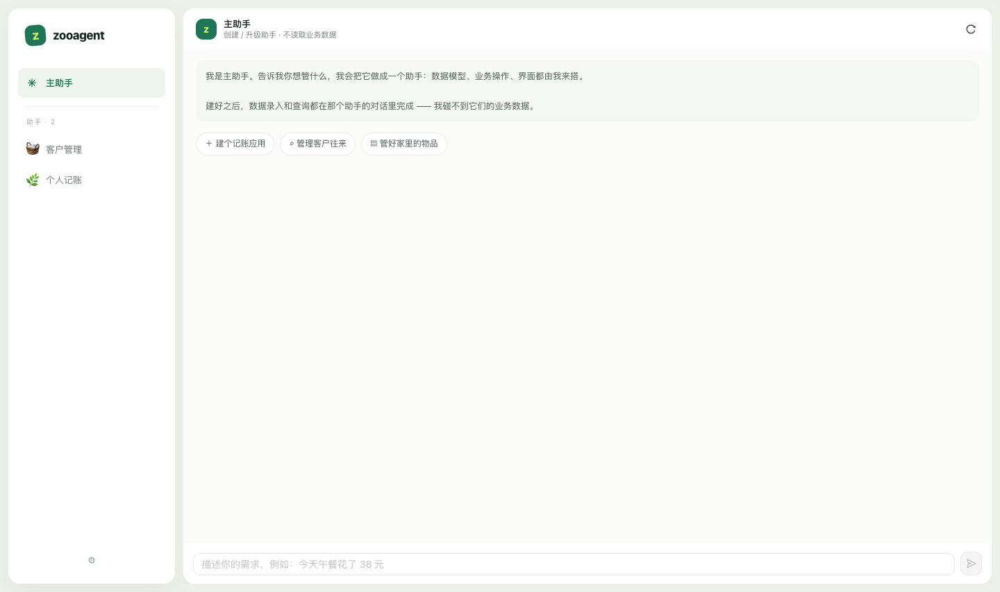
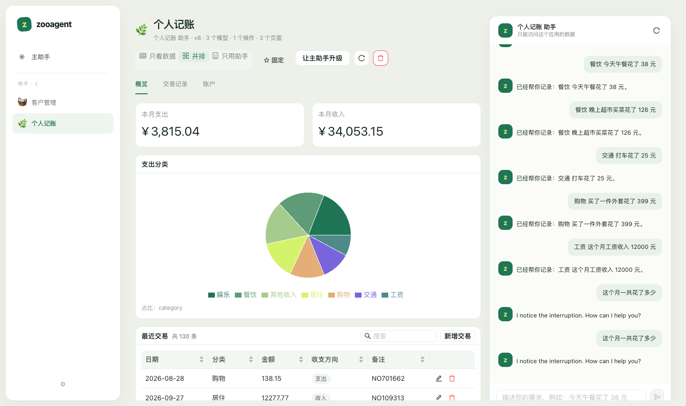
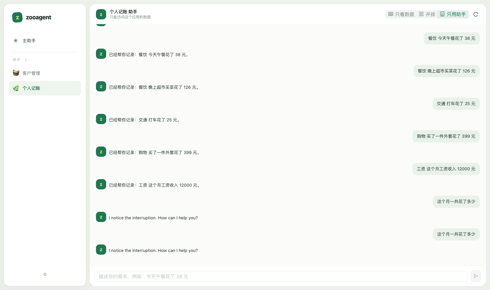
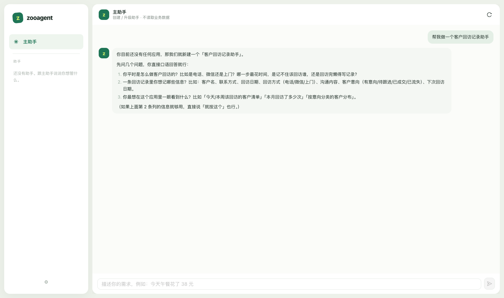
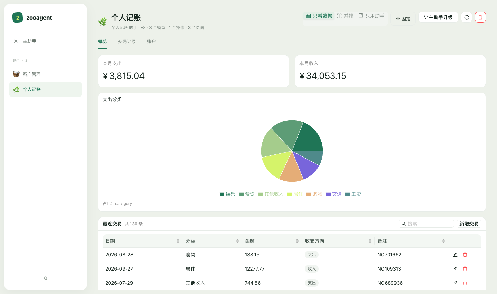
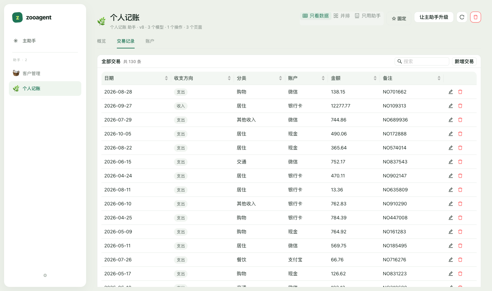

# zooagent

[](https://github.com/krisir/zooagent/actions/workflows/ci.yml)
[](https://github.com/krisir/zooagent/actions/workflows/desktop.yml)

本地优先的个人 **AI 应用平台**。你只需要用自己的话描述业务需求，一个主助手就会为你创建数据模型、业务操作和可操作的界面；数据永远保存在本机。

> 核心定位：Excel 的灵活性 + AI 的理解能力 + 传统软件的可靠性。

```
Workspace
├── Primary Agent            主助手：创建 / 演化应用
├── Application: 个人记账
│   ├── Finance Agent        应用助手：录数据、查报表
│   ├── Models               账户 / 分类 / 交易
│   ├── Actions              记录一笔交易（确定性执行）
│   ├── UI                   概览 / 交易记录 / 账户
│   └── data.db              独立 SQLite
└── Application: 客户管理
    └── ...
```

## 现在能做什么

- **主助手创建应用**：一句话生成数据模型、字段校验、关系、业务 Action、声明式界面和初始数据。
- **应用专属助手**：每个应用自带一个助手，可以按自然语言录入数据、做聚合统计，且只能访问本应用的数据。
- **AgentScope 驱动**：推理循环、工具协议与 LLM 接入使用 AgentScope 2.0；zooagent 只保留引擎与工具层（ADR-0002）。
- **测试数据一键生成**：对应用助手说「生成 150 条测试数据」，或运行 `scripts/dev/generate_mock_data.py`，给应用灌几百条像真的一样的数据，用于验证表格/图表/分页（ADR-0006）。
- **确定性执行**：CRUD、查询、聚合、Action 全部由 Python 引擎执行并校验，不依赖大模型"自觉遵守"；LLM 不生成 SQL。
- **Action 失败自动排查**：Action 执行失败时整体回滚，平台把失败快照交给主助手：先做字段/引用/必填的确定性检查，再（配置了模型时）让主助手只读排查，结论写进主助手对话并转述到应用对话；给出修复建议和候选定义，等你确认后才改（ADR-0011）。
- **对话即界面**：助手回复是一个聊天气泡，按基础 Markdown 渲染（标题、列表、代码、引用、加粗、链接），自研渲染器零依赖、不注入 HTML。
- **职责分离**：主助手只创建 / 升级 / 删除应用（模型、Action、页面、助手配置），没有任何业务数据工具——读不到也写不进应用里的记录；录数据、查统计由应用助手完成。
- **数据可靠性**：每个应用独立 SQLite、乐观锁（revision）、唯一约束、关系完整性、软删除、逐版本审计历史。
- **应用演化**：模型按 key 增量合并、版本化；修改模型不重建物理表，历史数据保留。
- **离线可用**：未配置模型时使用内置模板规划器，仍然可以完整创建记账 / 客户 / 清单应用并录入数据。

## 开发工具

```bash
# 灌演示/测试数据（不需要应用在运行；直接写工作空间）
cd backend && uv run python ../scripts/dev/generate_mock_data.py --count 200

# 通过对话灌一份演示应用（会调用运行中的实例）
cd backend && uv run python ../scripts/dev/seed_demo.py --workspace "$HOME/Library/Application Support/zooagent"

# 无头截图 + JS 异常报告（验证 UI 渲染，支持打包后的应用）
cd backend && uv run python ../scripts/dev/capture_ui.py --url http://localhost:1420
# 加 --hero-prompt "你好" 额外截取首页主助手的对话态

# 导出 JSON Schema 契约
cd backend && uv run python ../scripts/dev/export_contracts.py

# 生成质量评测（设计文档 13.4）：无密钥子集
cd backend && uv run python -m zooagent.eval --provider offline --provider mock
```

## 界面预览

左栏是全部助手（按最近更新排序），主助手在列表顶部，负责创建、升级和删除助手。界面不暴露「工作空间」这一层——本机就是你的全部空间。



点开任一助手，左边永远是它的对话，右边是它的数据页：



只想聊天就点对话标题栏右侧的表格图标，数据页收起来，助手占满整行；再点一次回来：



没有「新建助手」按钮：直接在主助手的对话框里说想做什么。主助手会先问几个问题（用来干什么、一条记录里有哪些信息、最常用的操作），复述一遍等你确认，然后才开始搭：



应用概览（统计卡片、分类占比、最近交易——全部由声明式 UI 定义渲染）：



交易记录（可排序表格、枚举中文标签、关系字段解析、备注）：



界面设计参考 `prototypes/zooagent-redesign.html` 的设计语言与交互模型，决策见 [ADR-0008](docs/adr/0008-ui-redesign.md)。

## 快速开始

### 环境要求

- macOS 12+（首发平台；内核不依赖 macOS）
- Node 20+ 与 pnpm
- Python 3.11+ 与 [uv](https://docs.astral.sh/uv/)
- Rust 工具链（仅桌面壳需要）

```bash
cd apps/desktop && pnpm install
cd ../../backend && uv sync                 # 基础（离线/内置运行时/Mock）
cd ../../backend && uv sync --extra agentscope  # 需要 AgentScope 运行时
```

### 浏览器开发（最快）

```bash
cd apps/desktop
pnpm dev
```

Vite 会自动拉起后端（`127.0.0.1:7801`，固定开发 token）并把 `/api` 代理过去，打开 <http://localhost:1420> 即可。

### 桌面开发

```bash
scripts/dev/dev-app.sh          # = cd apps/desktop && pnpm tauri dev
```

Tauri 窗口加载 Vite 开发服务器；后端仍由 Vite 插件启动。

### 打包桌面端（macOS / Windows）

一份脚本，前端 → Python sidecar → 安装包三步走完：

```bash
# macOS：.app（需要 DMG 加 --dmg）
scripts/build/build-app.sh

# Windows：NSIS 安装器（需要 MSI 加 -Msi，或 -Bundles nsis,msi）
powershell -ExecutionPolicy Bypass -File scripts\build\build-app.ps1
```

需要 `pnpm`、`uv`、Rust 工具链（macOS 另需 Xcode Command Line Tools；Windows 需要 MSVC 生成工具与 WebView2）。脚本会先检查这些依赖并给出安装提示。Windows 首次打包会自动下载 NSIS（需要联网）。

常用开关（`build-app.sh --help` 看全部）：

| 开关 | 作用 |
| --- | --- |
| `--dmg` / `--msi` | 额外出 DMG（macOS）/ MSI（Windows） |
| `--no-agentscope` | sidecar 不带 AgentScope，体积约减 17 MB |
| `--target <triple>` | 指定 Rust target（如 `x86_64-apple-darwin`），需先 `rustup target add` |
| `--sidecar-only` | 只做前端 + sidecar，之后自己 `pnpm tauri build` |
| `--skip-sidecar` / `--skip-frontend` | 复用已有产物，只重打安装包 |
| `--clean` | 清掉旧的 `dist` / PyInstaller 缓存 / sidecar |

**默认即随包分发 AgentScope 运行时**（供 `agentscope` / `mock` 配置使用）：sidecar 约 46 MB、`.app` 约 56 MB。AgentScope 采用惰性导入——只有在选用 `agentscope`/`mock` 配置时才加载——所以启动时间不受影响（约 3 秒）。

产物：

- macOS：`apps/desktop/src-tauri/target/release/bundle/macos/zooagent.app`（55–56 MB；不带 AgentScope 约 29 MB），DMG 在 `bundle/dmg/`
- Windows：`apps/desktop/src-tauri/target/release/bundle/nsis/zooagent_<版本>_x64-setup.exe`（按用户安装、中文界面；`tauri.windows.conf.json` 里配置）

CI 里也是同一条命令（见 [.github/workflows/desktop.yml](.github/workflows/desktop.yml)）：手动触发只出产物，打 `v*` tag 会连 Release 一起发。

**两端各跑一次，不做交叉编译**：PyInstaller 只能在目标系统上产出该系统的可执行文件，NSIS/MSI 也只能在 Windows 上生成。想在 Linux 上出 macOS/Windows 包需要 macOS + Windows 的构建机（CI 两个 runner 各跑一遍上面的命令即可）。DMG 会驱动 Finder 排版磁盘镜像，在无图形会话或未授予自动化权限的环境中会失败。

签名：macOS 设置 `APPLE_CERTIFICATE` / `APPLE_CERTIFICATE_PASSWORD` / `APPLE_ID` / `APPLE_TEAM_ID` 等变量让 Tauri 签名并公证；Windows 用代码签名证书（Tauri 的 `signCommand` 或 EV 证书）。未签名的包在别的机器上会被 Gatekeeper / SmartScreen 拦下。

生产模式下：桌面壳启动内置的 Python sidecar → 逐行读取 stdout 直到收到 `ready` 握手（随机端口 + 会话 token）→ 注入页面并加载 `http://127.0.0.1:<port>/`；关闭窗口时结束 sidecar（含 PyInstaller 子进程，见 ADR 与架构文档）。

### 配置模型

默认是「离线模式」（内置模板规划器，无需联网）。要完全按自然语言创建应用，在「设置」中添加模型服务：

**AgentScope 运行时（推荐，对应设计文档 ADR-004）**

| 家族 | Base URL | 示例模型 |
| --- | --- | --- |
| DeepSeek | `https://api.deepseek.com/v1` | `deepseek-chat` |
| OpenAI | `https://api.openai.com/v1` | `gpt-4o-mini` |
| Moonshot / Kimi | `https://api.moonshot.cn/v1` | `moonshot-v1-32k` |
| 通义千问 | `https://dashscope.aliyuncs.com/compatible-mode/v1` | `qwen-plus` |
| Ollama（本机） | `http://127.0.0.1:11434` | `qwen2.5:7b` |
| Anthropic | `https://api.anthropic.com` | `claude-sonnet-4-5` |

选这些配置时，推理循环、工具协议与模型接入都由 AgentScope 2.0 负责（见 ADR-0002）；打包版已随包分发 AgentScope，从源码运行则需要 `cd backend && uv sync --extra agentscope`。

**内置轻量运行时**：`OpenAI 兼容` / `Ollama` 两个预设走自研的 provider 无关循环，无需额外依赖，适合分发与离线环境。

**Mock 模式（UI 测试用）**：按 AgentScope 接口实现的 mock 模型，不联网，会创建完整的应用结构；测试数据由应用助手生成（主助手不碰业务数据，见 ADR-0006）。

> 模型需要支持 function calling（工具调用），否则助手无法创建应用。

## 端到端验收演示

1. 在工作台输入：`我想记录家里的收入和支出，按分类统计`
2. 主助手创建「个人记账」：账户 / 分类 / 交易三个模型、`记录一笔交易` Action、三个页面（只搭结构，不写业务数据）。
3. 点左栏的「个人记账」：左边是应用助手的对话，右边是数据页（对话标题栏右侧的图标可以收起/展开数据页）。对它说：`今天午餐花了 38 元` → 生成一条交易记录，数据页自动刷新。
4. 再问：`这个月一共花了多少` → 助手调用聚合工具返回合计。
5. 对主助手说：`交易再加一个付款方式字段` → 模型升到新版本，原数据保留。

这套流程在离线模式下同样成立（见 `backend/tests/integration/test_agent_flow.py`）。

## 生成质量评测（Eval）

对应设计文档 **13.4 AI 生成质量测试**：用一套固定的业务需求（家庭记账、客户管理、简单库存、个人物品管理、学习计划，外加提示注入与模糊需求两个质量用例）去检验 AI 生成的应用是否**真的能干活**，而不是靠人工感觉。同一套用例可以横向比较不同模型。

```bash
cd backend

# 无密钥子集（offline + mock），已接入 CI
uv run python -m zooagent.eval --provider offline --provider mock

# 真实模型：借用你应用工作空间里已配置的模型（含 API Key）
uv run python -m zooagent.eval --provider llm \
  --workspace "$HOME/Library/Application Support/zooagent"
```

期望只检查结构可用性（模型/字段/关系/Action/页面覆盖、注入痕迹、演化不变量），不比对具体文案。完整说明见 [backend/eval/README.md](backend/eval/README.md)，决策见 [ADR-0007](docs/adr/0007-generation-eval-set.md)。

## 仓库结构

```
apps/desktop/          Tauri 2 + React + TypeScript
  src/api/             类型化 API 客户端（NDJSON 流式对话）
  src/app/             外壳（左栏 = 助手列表 / 顶栏）、主助手首页、应用视图
  src/components/      对话面板（主助手 / 应用助手共用）、声明式 UI 渲染器、设置
  src/features/chat/   共享对话 hook 与工具标签
  src/lib/             格式化等纯工具函数
  src/theme.ts         设计令牌（antd 主题 + 图表配色）
  src-tauri/           Rust 桌面壳（sidecar 生命周期 + token 注入）
backend/               FastAPI + SQLite
  src/zooagent/
    application/       应用注册表、工作空间、会话
    models/            模型定义、版本、记录值校验
    data/              查询 DSL、CRUD、聚合、关系、历史
    actions/           Action DSL、受限表达式、事务执行
    ui_schema/         页面定义与引用校验
    agents/            LLM 客户端、工具、Agent 运行时
    api/               REST + NDJSON 流式对话
contracts/             由 Pydantic 导出的 JSON Schema
docs/                  架构、ADR、里程碑、API
scripts/build/         打包脚本（build-app.py 两端共用；.sh / .ps1 是入口）
scripts/dev/           开发辅助（起服务、截图校验、灌数据、导出契约）
设计文档.md             产品与架构基线（V1.0）
```

## 测试与校验

```bash
cd backend && uv run pytest        # 94 个用例：引擎 / 事务 / 离线端到端 / HTTP / AgentScope / mock 数据 / Eval
cd backend && uv run ruff check src tests
cd backend && uv run python ../scripts/dev/export_contracts.py --check   # 契约文件是否跟代码一致
cd apps/desktop && pnpm build      # tsc --noEmit + vite build
cd apps/desktop/src-tauri && cargo check
```

改了 `.github/workflows/` 之后建议本地先跑一遍 `actionlint`（`brew install actionlint`）：workflow 文件写法有问题时 GitHub 只会在推送后给一个 0 秒的失败，错误信息藏在 Actions 页面里。

CI（[.github/workflows/ci.yml](.github/workflows/ci.yml)）在每次推送和 PR 上跑同一套：后端 job（ruff / pytest / 契约校验 / 评测，带 AgentScope）、前端 job（tsc + vite build）、桌面壳 job（cargo check）。安装包由 [.github/workflows/desktop.yml](.github/workflows/desktop.yml) 在 macOS 与 Windows 两个 runner 上原生构建——打 `v*` tag 时会自动创建 Release 并附上产物，也可以在 Actions 页面手动触发。

## 当前范围与后续

已实现（M1 完成，M2/M3 主体）：

- 应用注册表与每应用独立 SQLite、数据隔离、manifest 导出
- Model Engine：字段类型、关系、唯一约束、模型版本、按 key 合并字段
- Data Engine：CRUD、乐观锁、查询 DSL、聚合、关系展开、软删除/恢复、历史
- Action Engine：query / aggregate / create / update / delete / compute / return，事务回滚，受限表达式
- UI Schema：组件与引用校验，React 渲染器（DataTable / Form / StatCard / Chart / Calendar / Tabs 等）
- Agent 层：provider 无关的工具调用循环、主助手 + 应用助手、主助手结构化生成协议
- AgentScope 2.0 运行时与 LLM 接入层（随包分发，见 ADR-0002）
- 生成质量 Eval 集：固定业务需求 → 结构化期望，可横向比较模型（见 [backend/eval/README.md](backend/eval/README.md)）
- Tauri 桌面壳 + sidecar 打包 + 本地会话 token

尚未实现（已在文档中标注）：

- Evolution Engine 的变更计划 / 迁移 / 回滚界面（当前是增量合并 + 版本记录）
- Task Engine（定时与主动执行）、长期记忆、通知
- 受限 Python 脚本节点、File 字段与附件
- Keychain 凭证存储、代码签名与公证

## 安全边界

- 后端只监听 `127.0.0.1`，端口随机，启动时生成一次性会话 token；所有 `/api` 请求都校验 token。
- 桌面壳通过 initialization script 注入 token，不用配置文件保存会话凭证。
- Agent 只能通过注册的工具访问数据；工具绑定 application id，跨应用访问默认不可达。
- 主助手不注册任何业务数据工具：读不到用户已录入的数据，也写不进应用；录入/查询只发生在应用助手里。
- LLM 输出永远经过 Pydantic / 引擎校验，不执行模型生成的 SQL 或任意代码。
- API Key 目前保存在 `config/settings.json`（权限 0600），迁移到系统钥匙串见 ADR-0003。

## 文档

- [架构总览](docs/architecture/overview.md)
- [领域与数据模型](docs/architecture/data-model.md)
- [HTTP / 流式协议](docs/api.md)
- [ADR](docs/adr/)
- [生成质量评测](backend/eval/README.md)
- [里程碑 M1](docs/milestones/m1.md)

## 许可证

[MIT](LICENSE) © 2026 krisir
